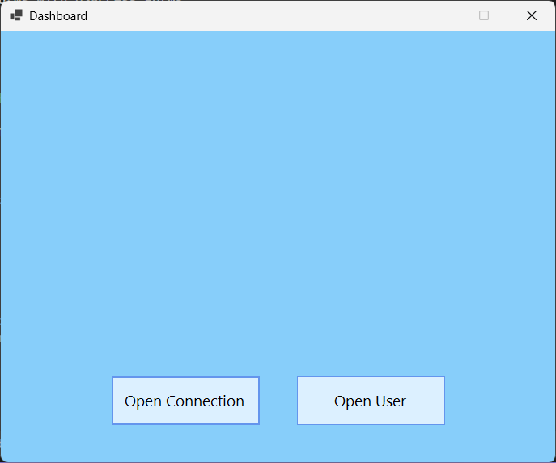
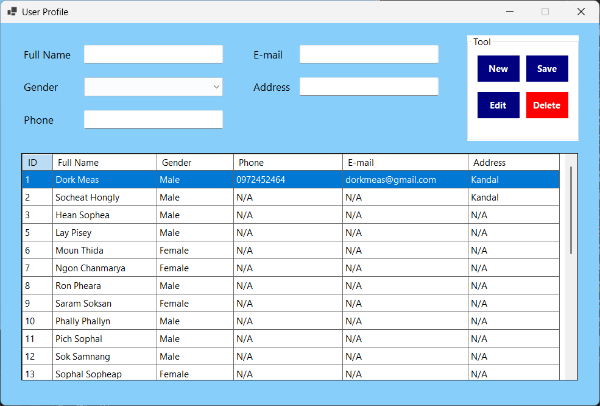

# WinForms with MS Access

A C# Windows Forms application demonstrating Microsoft Access database connectivity using `System.Data.OleDb` and **.NET 10**.

This project implements full CRUD (Create, Read, Update, Delete) functionality for managing user information.

---

## Screenshots

### Dashboard

The main screen for testing the database connection and opening the User Profile form.



### User Profile

A form for managing user information with full CRUD operations.



---

## Features

| Action | Description |
|--------|-------------|
| **Open Connection** | Test the connection to `dbStore.mdb`. |
| **Open User** | Open the User Profile form. |
| **New** | Clear the form and enter Insert mode. |
| **Save** | **Create** — Add a new user record. |
| **Click Row** | **Read** — Load the selected user's information into the form. |
| **Edit** | **Update** — Modify the selected user record. |
| **Delete** | **Delete** — Remove the selected user record with confirmation. |

---

## Requirements

- [.NET 10 SDK](https://dotnet.microsoft.com/download)
- Microsoft Access Database Engine (ACE.OLEDB.12.0)
- Microsoft Access (for creating and viewing the database)

---

## Database Setup

1. Create a Microsoft Access database named **`dbStore.mdb`**.
2. Create a table named **`tbUserInfo`** with the following fields:

| Field | Data Type | Description |
|-------|-----------|-------------|
| `ID` | AutoNumber | Primary Key |
| `fullname` | Short Text | Full name |
| `gender` | Short Text | Gender |
| `phone` | Short Text | Phone number |
| `email` | Short Text | Email address |
| `address` | Short Text | Residential address |
| `ustatus` | Short Text | User status (e.g., Active) |
| `utrash` | Short Text | Trash flag (`0` = Normal) |

3. Place `dbStore.mdb` in the following directory:

```text
bin/Debug/net10.0-windows/
```

> **Important:** Close Microsoft Access before running the application to avoid potential file access conflicts, such as the `file already in use` error.

---

## How to Run

Clone the repository and run the application:

```bash
git clone https://github.com/dorkmeas/WinForms-with-MS-Access.git
cd WinForms-with-MS-Access
dotnet restore
dotnet run
```

Alternatively, open `WinForms_with_MSAccess.slnx` or the `.csproj` file in **Visual Studio** and press **F5** to run the application.

---

## Project Structure

```text
WinForms-with-MS-Access/
├── Forms/
│   ├── Dashboard.cs
│   ├── Dashboard.Designer.cs
│   ├── UserProfile.cs
│   └── UserProfile.Designer.cs
├── docs/
│   └── images/
│       ├── dashboard.png
│       └── user-profile.png
├── Program.cs
├── WinForms_with_MSAccess.csproj
├── LICENSE
└── README.md
```

---

## Tech Stack

- **Language:** C#
- **Framework:** Windows Forms (WinForms)
- **Runtime:** .NET 10 (`net10.0-windows`)
- **Database:** Microsoft Access
- **Data Provider:** `System.Data.OleDb`
- **Database Provider:** Microsoft ACE OLEDB

---

## Git History (Feature Commits)

The following commits represent the development of the CRUD functionality:

```text
feat(delete): implement Delete button for selected user
feat(update): implement Edit button to update selected user
feat(read): select DataGridView row to load user into form
Add WinForm with Insert
```

---

## License

This project is licensed under the [MIT License](LICENSE).